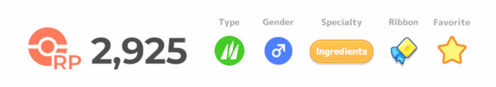
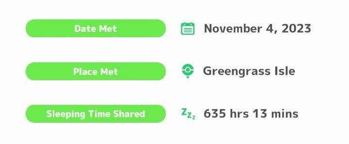

Pokémon earn Good-Night Ribbons by sleeping on your team for a target number of hours. Ribbons provide small perks, as described below.

## What is a Good-Night Ribbon?

Good-Night Ribbons are earned and upgraded by hitting milestones for sleep time shared. Each ribbon provides a stat boost, with larger ribbons providing better boosts and not-fully-evolved (NFE) Pokémon gaining an additional boost.

The ribbon will be at the top right of the Pokémon's summary screen and "Sleeping Time Shared" is at the bottom of the summary screen. These ribbons are specific to a Pokémon and not shared by the species.

> [!NOTE]
> "Sleeping Time Shared" includes all time spent on the active team during a sleep session (including manually entered sleep sessions). It counts the total length of a sleep session (including the time taken to fall asleep), up to 13 hrs/day. Time spent on Munchlax's Nap Island does not count towards sleep time shared.

## Ribbon on Fully Evolved Pokémon

|Ribbon|Stat Boosts|
|:-:|:-|
|:ribbon1: **200 hours**|+1 Carry Limit|
|:ribbon2: **500 hours**|+3 Carry Limit|
|:ribbon3: **1k hours**|+6 Carry Limit|
|:ribbon4: **2k hours**|+8 Carry Limit|

Any Pokémon that would benefit from an increased Carry Limit will like a ribbon. Ingredient Specialists and Skill Specialists in general appreciate ribbons, as the higher Carry Limit allows more time overnight to collect ingredients and procs, respectively, before Sneaky Snacking. Berry Specialist with useful ingredients or skills appreciate it for the same reason.

Actually getting the ribbon on these Pokémon, however, will be quite difficult. Pokémon with low Carry Limits are usually not optimal to run overnight as they spend most of the night Sneaky Snacking, so earning ribbons on them requires more sacrifice. Ribbons should not be viewed as an easy fix for low Carry Limit Pokémon.

Healers are the Pokémon that most easily get a ribbon because they are almost always on the team.

## Ribbon on NFE Pokémon

Not-fully-evolved Pokemon gain additional benefits, alongside the Carry Limit increase, based on the number of remaining evolutions they have available. For example, a Pichu has 2 evolutions remaining, a Pikachu has 1, and a Raichu is fully evolved and does not gain these additional benefits.

|Ribbon|1 Evolution Left|2 Evolutions Left|
|:-:|:-:|:-:|
|:ribbon1: **200 hours**|-|-|
|:ribbon2: **500 hours**|+5% speed|+11% speed|
|:ribbon3: **1k hours**|+5% speed|+11% speed|
|:ribbon4: **2k hours**|+12% speed|+25% speed|

Any speed boost provided by a ribbon will be reflected in the frequency on the Pokémon's summary screen.

> [!NOTE]
> Costume Pokémon, like Halloween Pikachu and Holiday Spheal, cannot evolve and do not receive the evolution-based boosts, despite their less-fashionable forms having evolutions.

For the majority of NFE Pokémon, the stat boosts provided by a ribbon are not sufficient to outperform their final evolution. For the few exceptions to this, it is important to keep in mind that getting a 2k ribbon requires ~235 nights with 100 Sleep Score, which is a massive investment of time and sleep EXP that should be considered when determining the practicality of these Pokémon.

:pikachu: **Pikachu** with a 2k ribbon has a respectable performance as an Electric Berry Specialist, though still inferior to Raichu. It has niche use as another Electric Berry Specialist species on a Raikou team. However, Halloween Pikachu and Captain Pikachu are not much weaker than 2k Pikachu while requiring far less investment.

:onix: **Onix** with a 2k ribbon is the strongest Rock Berry Specialist, which would otherwise be Tyrantrum. Steelix is a Steel Berry Specialist, so Onix does not need to outperform it. However, Tyrantrum is not much weaker than Onix while being much easier to hunt, requiring far less investment, and having a strong skill.

:chansey: **Chansey** with a 2k ribbon has similar performance to Blissey with a 2k ribbon as an Ingredient Specialist for Egg. It can very rarely outperform Blissey but only by an insignificant amount. During the time it takes to get the ribbon, it will underperform Blissey.

:vigoroth: **Vigoroth** with a 2k ribbon is far superior to Slaking as a Normal Berry Specialist. Slaking is slower and has a much higher ingredient rate, with 2k ribbon widening the speed gap further. However, Vigoroth is not a strong Berry Specialist even with the ribbon and is not much stronger than Raticate, which requires far less investment.

:prinplup: **Prinplup** with a 2k ribbon is the second strongest Water Berry Specialist. Empoleon is a Steel Berry Specialist, so Prinplup does not need to outperform it. It has niche use as another Water Berry Specialist species on a Suicune team.

If you have a favorite Pokémon that is NFE, the ribbon can at least make their performance a little better.

## Smiling Profile Icon

The 1k ribbon also unlocks a special smiling profile icon in a gold frame with a 1k ribbon on it.

|Normal Icon/Frame|1k Ribbon Icon/Frame|
|:-:|:-:|
|||

> [!NOTE]
> Evolving a Pokémon that has a 1k ribbon will unlock the profile icon for its evolution as well. However, getting a 1k ribbon on an evolved Pokémon will not unlock the profile icon for its previous evolutions.
