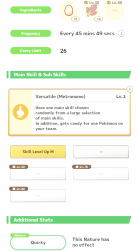

Mew is a Mythical Pokémon that can be built for many different roles, though it functions best when built for strength or as a cooking supplement.

## What stats slots can Mew roll?

When you first get Mew, it will have Versatile (Metronome) as its main skill, Egg and Herb as its first two ingredients, Skill Level Up M as its only sub skill, and Quirky as its nature.

Eureka Seed (Mew) allows you to choose either the main skill, an ingredient slot or a sub skill slot to roll.

* If you choose the main skill, a random main skill out of a pool will be added to your learned main skill list (which only has Metronome at the start) and you will be given the option to switch to any main skill on that list.
* If you choose an ingredient slot or a sub skill slot, you will given the option to switch to a random ingredient out of a pool or a random sub skill in that slot, respectively. Sub skill rarity is ignored, so all sub skills have an equal chance of being rolled.

Choosing to stay with your current roll rather than switch to the new one gives you 40 Mew candy as compensation.

:::details Ingredient Pool and Quantities :soybean: :sausage: :egg: :oil: :herb: :avocado: :leek: :tail:
|Ingredient|Lv. 1|Lv. 30|Lv. 60|
|:-:|:-:|:-:|:-:|
|:soybean: Greengrass Soybeans|x2|x5|x7|
|:sausage: Bean Sausage|x2|x4|x7|
|:egg: Fancy Egg|x2|x4|x6|
|:oil: Pure Oil|x2|x4|x6|
|:herb: Fiery Herb|x2|x4|x5|
|:avocado: Glossy Avocado|x2|x3|x4|
|:leek: Large Leek|x2|x3|x4|
|:tail: Slowpoke Tail|-|-|x2|
:::

### Versatile Explained

Versatile is Mew's unique main skill. To make it easier to understand, it can be divided into three separate parts.

1. **Candy**
   * Each proc will always provide 1 candy for a random Pokémon on your team. The quantity of candy does not increase with skill level.
2. **Bonus Candy**
   * Starting at skill level 6, each proc has a 30% chance of receiving 1 bonus candy for that same Pokémon. The quantity of candy increases by one with each skill level but the chance stays the same.
3. **Set Main Skill**
   * This is the part of Versatile that can be rolled. Though Versatile can go up to skill level 8, the set main skill will not go over its current max skill level. For example, if the set main skill's current max skill level is 7, then its effect will be the same for Versatile skill level 7 and 8. (Versatile's bonus candy is not affected by the set main skill's max skill level.)

:::details :versatile: Versatile's Set Main Skill Pool
:chargestrength: Charge Strength S (Ranged)

:chargestrength: Charge Strength M

:shardmagnet: Dream Shard Magnet S (Ranged)

:ingmagnet: Ingredient Magnet S

:energyskill: Energizing Cheer S

:energyskill: Charge Energy S

:energyskill: Energy for Everyone S

:tastychance: Tasty Chance S

:potup: Cooking Power-Up S

:extrahelpful: Extra Helpful S

:berryburst: Berry Burst
:::

<SubjectiveInfoBanner />

## Is Mew good?

Unlike other Pokémon, Mew has multiple main skill options and its base skill trigger rate is dependent on its set main skill. ([Rates based on RaenonX's testing and hypothesis.](https://pks.raenonx.cc/en/mainskill/info/34))
* **Low Trigger Rate (~3%)** - Energy for Everyone, Berry Burst
* **Medium Trigger Rate (~4%)** - Charge Strength M, Energizing Cheer, Dream Shard Magnet, Extra Helpful, Ingredient Magnet, Cooking Power-Up, Metronome, Tasty Chance
* **High Trigger Rate (~6.5%)** - Charge Strength S, Charge Energy

Before getting into evaluating the skills, it is important to address the candy portion of Mew's skill:
* Regardless of Mew's set main skill, candy generation gives it a unique niche that nothing else does nearly as well. The higher the proc rate of your set main skill or build, the more candy generated per day.
* Mew's performance should be the primary factor in evaluating set main skill options. Candy generation should only be considered when comparing similar performing set main skills or different builds.

Mew's performance with support skills is very underwhelming compared to the competition.
* :energyskill: **Energy for Everyone** - Gets <4 procs even with its highest proc build, falling very short of the suggested minimum proc count for healers. It is much  weaker than an equivalent Wigglytuff or Sylveon, both of which are bottom tier healers, while having a lower ceiling due to its locked neutral nature. It does not have a niche for Psychic-favored Expert Mode as Gardevoir far outperforms it.
* :shardmagnet: **Dream Shard Magnet** - Matches an equivalent Persian, the worst Dream Shard Magnet option, in shard production while having a lower ceiling due to its locked neutral nature.
* :energyskill: **Energizing Cheer**, :ingmagnet: **Ingredient Magnet** - Gets ~4.5 procs even with its highest proc build, well below both the suggested minimum proc count and its competition for these roles.
  * :tastychance: **Tasty Chance** and :potup: **Cooking Power-Up** also fall in this category and have the same evaluation, but they do have a use, as discussed later.
* :energyskill: **Charge Energy** - Mew is not strong enough by itself to not need a functional main skill, so this is practically useless.

### Strength Build

Strength-producing main skills (except Extra Helpful) are more promising for Mew.
* :berryburst: **Berry Burst** - With a leveled team, Berry Burst Mew is stronger than an equivalent Espeon as well as Charge Strength M or S Mew, with the gap being larger with more favored berry teammates. Finds the least candy of the three options (and any main skill option).
* :chargestrength: **Charge Strength M** - Stronger than an equivalent Espeon and Charge Strength S Mew.
* :chargestrength: **Charge Strength S** - Roughly as strong as an equivalent Espeon. Finds the most candy of the three options (and any main skill option except Charge Energy), roughly 40-50% more than Charge Strength M and 80-90% more than Berry Burst.

Espeon has a higher ceiling due to Mew's neutral nature and, as a result, peak build Espeon is stronger than peak build Mew. Espeon is also a stronger generalist than Mew, regardless of main skill, as it is less reliant on its berry strength than Mew.

### Cooking Build

Cooking supplement is another possible route for Mew.
* Mew has a good selection of ingredient options but its production is too low to be ran purely as an Ingredient Specialist. (Leeks are a possible exception, with its production falling between Quaquaval and Farfetch'd.) Instead, it can be used for supplemental ingredients, with an ingredient list tailored to your needs.
* Mew cannot compete with better :tastychance: **Tasty Chance** options, but it can assist with procs, speeding up your cooking. :potup: **Cooking Power-Up** is also an option, though more situational in its usefulness.

## How should I use Eureka Seeds?

### Strength Build

These steps prioritize getting Mew online by lv. 50 over making it perfect at lv. 70.
1. Roll the second and third sub skill slots (lv. 25, 50) once.
2. Reroll the first three sub skill slots until you get any of **Berry Finding S**, **Helping Bonus**, **Helping Speed M**, or **Skill Trigger M**.
   * If you roll the **S** version of an **M** sub skill, keep it. A Sub Skill Seed is cheaper than a Eureka Seed (for Premium Pass) and it would likely take multiple Eureka Seeds to roll the upgraded **M** versions in its place. However, do not Sub Skill Seed it until you have finished rolling the other slots as you may roll the **M** version in one of them.
   * If you wish to start using Mew sooner, you can move to the next step after rolling 2 of the desired sub skills and return after completing that step.
3. Reroll the main skill until you get your choice of **Berry Burst**, **Charge Strength M**, or **Charge Strength S**.
   * Consider stopping when you get any one of these and coming back later to hunt the one you prefer.
4. Roll the empty ingredient slot once.
5. Reroll each ingredient slot until you have a list that works well for you.
6. Roll and reroll the 4th sub skill slot (lv. 70) until you get one of the above sub skills.

If you wish to aim for a perfect build by lv. 70, potentially taking longer to be usable at lv. 50, roll and reroll the 4th sub skill slot at the same time as the first 3 slots. Keep in mind that taking Mew to lv. 70 takes over twice as much EXP as it does for normal Pokémon.

> [!NOTE]
> It is generally better to reject rolls that aren't what you need and receive 40 Mew candy instead. While it doesn't impact the build process if you don't, rejecting rolls is a great way to accumulate Mew candy, which is otherwise rare.
>
> If you are using Mew while in the process of building it, certain sub skills can still provide value despite not being one of the desired ones. Notable examples include Sleep EXP Bonus to help you level Mew faster if you are leaving it overnight and Skill Level Up S/M to increase your main skill level if you haven't maxed it yet.

### Cooking Supplement Build

The same steps as above can be used but with **Ingredient Finder M** in place of **Berry Finding S** in the sub skill list and **Tasty Chance** or, if it would benefit you more, **Cooking Power-Up** as the main skill options.